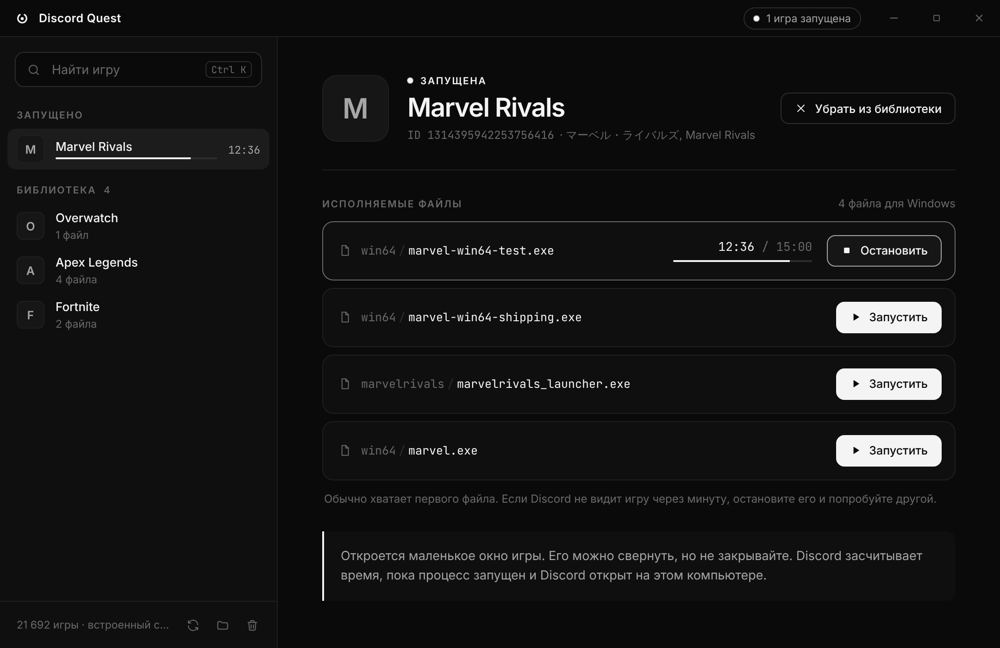

# Discord Quest

Discord Quest выполняет игровые задания Discord (Quests вида «поиграйте 15 минут»)
без установки самой игры.

[**Скачать DiscordQuest.exe**](https://github.com/waluwe/discord-quest/releases/latest) · один файл, установка не нужна

> **Внимание.** Запуск поддельных игровых процессов нарушает Условия использования Discord.
> Discord может не засчитать награду, ограничить задания или заблокировать аккаунт.
> Вы используете программу на свой риск. Проект не связан с Discord Inc.

## Возможности

- Поиск по всем играм, которые распознаёт Discord (более 20 000).
- Запуск игры одной кнопкой, без скачивания самой игры.
- Таймер и прогресс до 15 минут для каждой запущенной игры.
- Библиотека игр, которая сохраняется между запусками.
- Можно запустить несколько игр одновременно.
- Интерфейс на русском.
- Один portable EXE, права администратора не нужны.

## Как пользоваться

1. Скачайте `DiscordQuest.exe` со страницы [Releases](https://github.com/waluwe/discord-quest/releases/latest) и запустите.
   Если Windows SmartScreen предупредит о неизвестном издателе, нажмите «Подробнее» → «Выполнить в любом случае».
2. Откройте Discord на этом же компьютере и примите игровое задание.
3. В Discord Quest найдите игру из задания и нажмите **Запустить**.
4. Подождите 15 минут (окно игры можно свернуть) и заберите награду в Discord.

Если через минуту Discord не показывает игру в статусе, остановите файл и попробуйте другой из списка.

Нужен WebView2. Он уже есть в Windows 11 и в обновлённой Windows 10.

## Как это работает

1. Приложение загружает список игр, которые Discord умеет распознавать
   (`GET https://discord.com/api/v9/applications/detectable`), и кэширует его на 12 часов.
2. Для выбранной игры оно копирует крошечную программу-заглушку под именем и путём
   исполняемого файла игры, например `games/<id>/steamapps/common/Game/game.exe`.
3. Заглушка запускается и показывает маленькое окно. Discord видит процесс с нужным именем
   и считает, что вы играете. Прогресс задания идёт, пока заглушка запущена, а Discord открыт.

Программа не входит в ваш аккаунт, не читает токен и не меняет файлы Discord.
Заглушки лежат в `%LOCALAPPDATA%\Discord Quest\games`, их можно открыть и удалить
кнопками внизу боковой панели. При закрытии приложения все заглушки останавливаются.

Работает только для заданий «поиграть N минут». Задания со стримом или просмотром видео так не выполнить.

## Права

© 2026 waluwe. Все права защищены.
Discord является товарным знаком Discord Inc. и упоминается только для описания.
